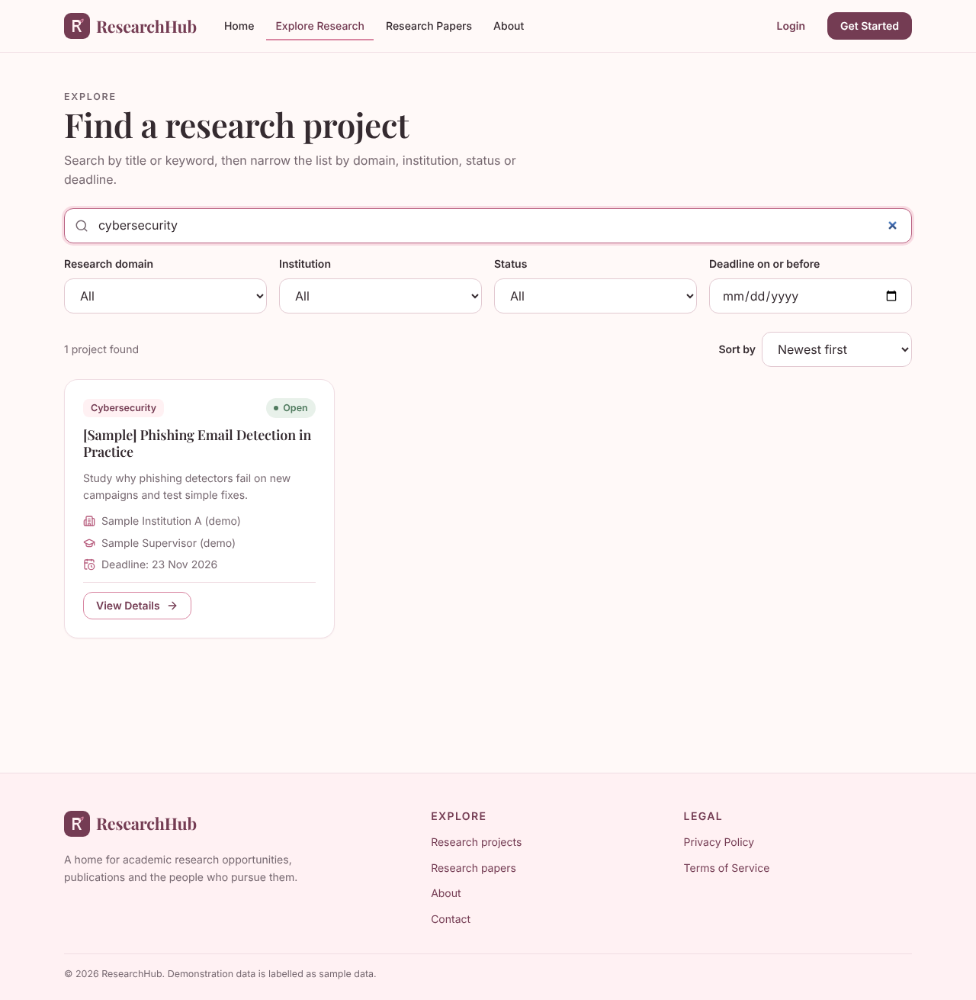
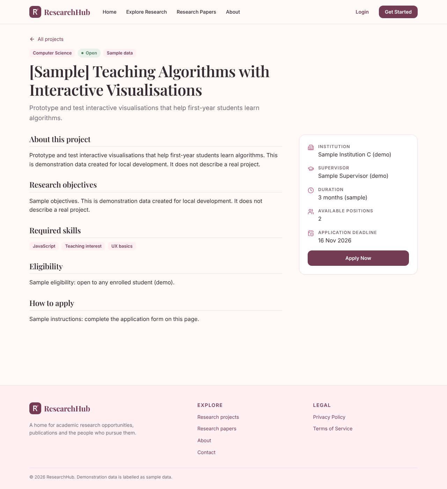
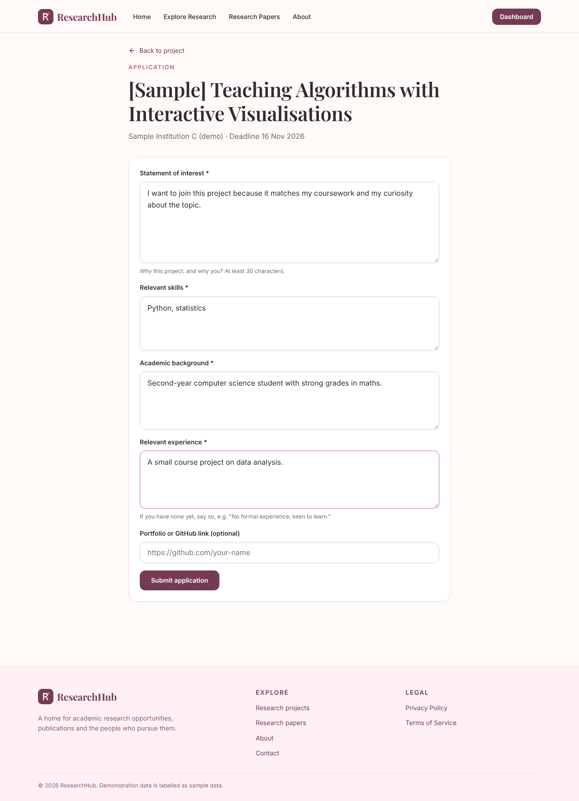
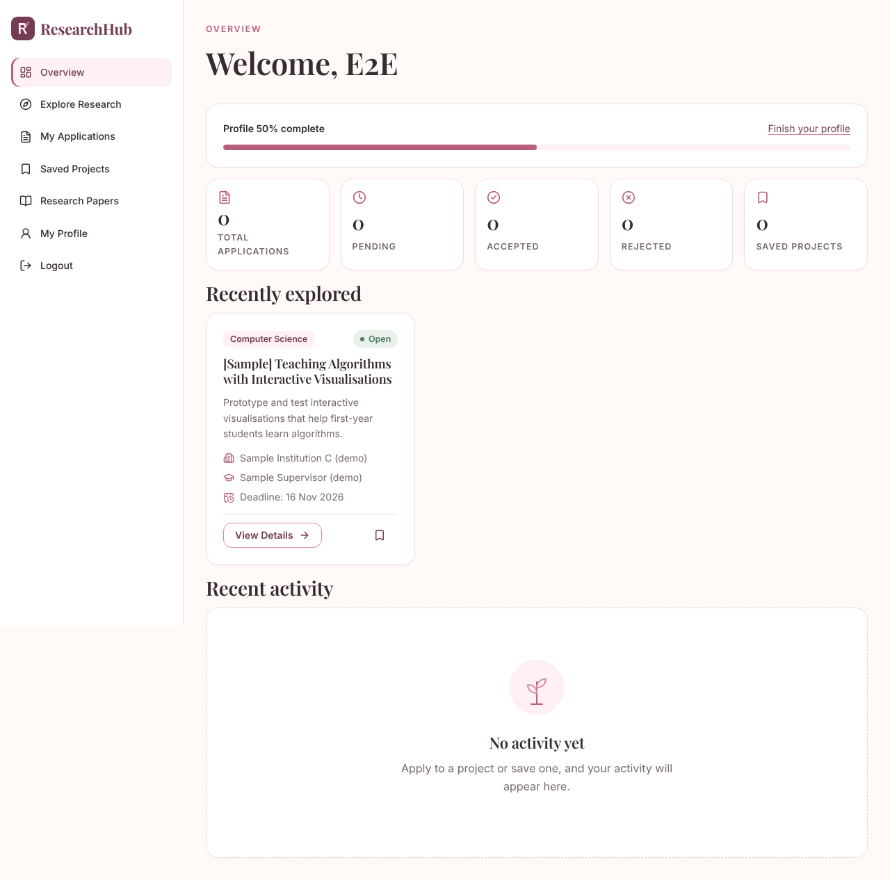
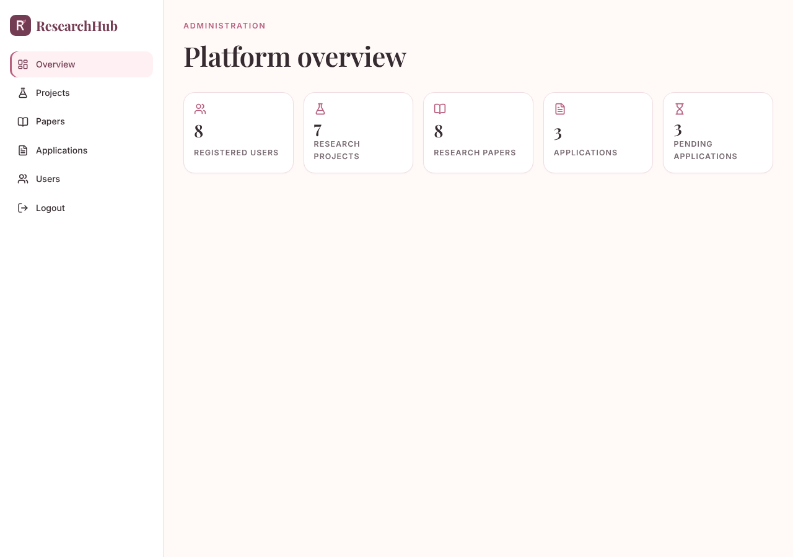
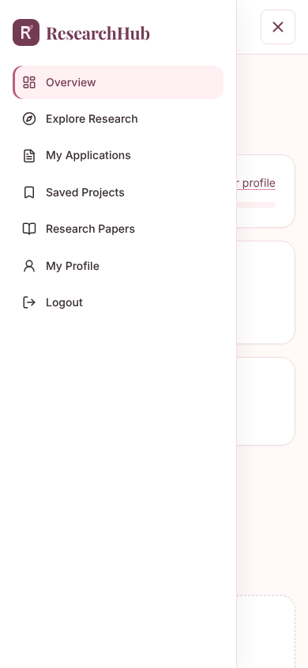

# ResearchHub

An academic research discovery and collaboration platform. Students and researchers can find research projects, browse a paper library, apply to projects and track their applications; administrators manage the content and review applications.

> **Status:** all twelve planned phases are built and tested (see [Testing](#testing)). It has **not** been deployed anywhere or reviewed by a security professional, and the legal pages are drafts. See [Known limitations](#known-limitations) before using it with real people.

## Problem and objectives

Research opportunities are scattered across department pages, mailing lists and notice boards. ResearchHub puts projects, publication details and applications in one place so that:

- students can find and apply to projects that fit them, and see where each application stands;
- administrators can publish projects, curate a paper library and review applicants in one interface;
- the whole thing is a worked example of a secure full-stack application (React, FastAPI, PostgreSQL).

## Features

| Area | What it does |
|------|--------------|
| Public | Landing page fed by the database; Explore page with keyword search, filters (domain, institution, status, deadline), sorting and pagination, all kept in the URL; project details; paper library with search and filters |
| Accounts | Register, log in, log out, forgot and reset password, "remember me" (30 days instead of 8 hours) |
| Student / researcher | Dashboard (counts, profile completion, recent activity), apply with a structured form, My Applications, saved projects and papers, profile editing, change password |
| Administrator | Overview totals; create, edit, archive and delete projects and papers; review applications and change their status; search users and suspend or restore accounts |
| Design | Baby-pink academic identity, Playfair Display + Inter (self-hosted), responsive layouts, keyboard and screen-reader support, reduced-motion support |

## Technology

- **Frontend:** React 19, Vite, React Router, Axios, Lucide icons, plain CSS with design tokens. Tests: Vitest + Testing Library.
- **Backend:** Python 3.12+, FastAPI, SQLAlchemy 2, Alembic, Pydantic 2, Argon2id (`argon2-cffi`), SlowAPI rate limiting. Tests: Pytest against a real PostgreSQL database.
- **Database:** PostgreSQL 16.

## Architecture

```
Browser (React SPA)  --/api/*, HttpOnly cookie + CSRF header-->  FastAPI  --SQLAlchemy-->  PostgreSQL
```

- The browser only ever talks to `/api/...` on its own origin. In development Vite forwards that to the backend; in production Vercel forwards it. This keeps cookies same-site.
- Routers (HTTP) call services (rules) which use models (tables). Pydantic schemas validate everything coming in and shape everything going out.
- Every permission check happens on the server. The React route guards only improve the experience.

```
researchhub/
├── backend/app/{core,database,models,schemas,dependencies,routers,services,tests}
├── backend/alembic/            database migrations
├── frontend/src/{components,pages,layouts,hooks,services,context,styles,utils}
├── e2e/e2e.cjs                 browser test against a running stack
├── docs/screenshots/
├── docker-compose.yml          local PostgreSQL
├── render.yaml                 backend + database blueprint
└── frontend/vercel.json        frontend config and API proxy
```

## Database schema

| Table | Purpose and key rules |
|-------|----------------------|
| `users` | Email unique and always lowercase; role is `student`, `researcher` or `admin`; `password_hash` is Argon2id; `is_active` lets an admin suspend an account |
| `research_projects` | Unique `slug`; status `open`, `ongoing`, `completed`, `closed` or `archived`; indexed by status, domain, institution and deadline; `is_sample` marks demo data |
| `research_papers` | Metadata and a link to the source only; unique DOI (when present); year range checked |
| `applications` | **Unique `(user_id, project_id)`** (one application per project, enforced by the database); status `submitted`, `under_review`, `shortlisted`, `accepted`, `rejected`; a project with applications cannot be deleted |
| `bookmarks`, `paper_bookmarks` | Saved projects and papers, unique per user and item (`paper_bookmarks` is an addition to the original schema) |
| `sessions` | Stores only a SHA-256 hash of the session token, plus expiry |
| `password_reset_tokens` | Hashed, single use, expiring |

Deleting a user removes their applications, bookmarks and sessions. Migrations live in `backend/alembic/versions`, and a test fails if the models and migrations drift apart.

## API

Interactive docs are served at `/api/docs` in development (disabled in production). All errors look like `{"detail": "..."}` (or a list of `{loc, msg}` for validation errors).

| Method and path | Who | Notes |
|-----------------|-----|-------|
| `GET /api/health`, `/api/health/ready` | public | liveness, and database reachability |
| `GET /api/auth/csrf` | public | sets the CSRF cookie |
| `POST /api/auth/register` | public | signs the new user in; role limited to student or researcher; 20/hour per IP |
| `POST /api/auth/login` | public | 10/minute per IP |
| `POST /api/auth/logout` | user | destroys the session on the server |
| `GET /api/auth/me` | user | current user |
| `POST /api/auth/forgot-password` | public | always answers the same; 5/hour per IP |
| `POST /api/auth/reset-password` | public | single-use token; signs out every session; 10/hour per IP |
| `GET /api/projects`, `/filters`, `/{id}` | public | filters: `q, domain, institution, status, deadline_before, sort, page, page_size`; archived projects hidden |
| `POST /api/projects`, `PUT/DELETE /api/projects/{id}` | admin | delete refused if applications exist (archive instead) |
| `GET /api/papers`, `/filters`, `/{id}` | public | filters: `q, category, year, sort, page, page_size` |
| `POST /api/papers`, `PUT/DELETE /api/papers/{id}` | admin | |
| `POST /api/applications` | user | blocked if the project is not open, the deadline has passed, or you already applied |
| `GET /api/applications/my` | user | only your own |
| `GET /api/applications/{id}` | owner or admin | someone else's returns 404 |
| `GET /api/admin/stats`, `/applications`, `/users` | admin | search, filter, paginate |
| `PATCH /api/admin/applications/{id}/status` | admin | |
| `PATCH /api/admin/users/{id}` | admin | suspend or restore |
| `GET/PUT /api/users/me`, `PATCH /api/users/me/password` | user | never returns hashes |
| `GET/POST /api/bookmarks`, `DELETE /api/bookmarks/{id}` | user | projects and papers |

## Security measures

- **Passwords:** Argon2id with per-password salt; minimum 10 characters; never logged or returned.
- **Sessions:** random token in an `HttpOnly`, `SameSite` cookie (`Secure` in production); only its hash is stored; logout, password reset and suspension end sessions on the server. Sessions last 8 hours, or 30 days with "remember me".
- **CSRF:** double-submit token (`csrf_token` cookie echoed in `X-CSRF-Token`) plus an `Origin` check on every write request.
- **Authorization:** `require_user` and `require_admin` dependencies on every protected route; users can only reach their own applications and profile. Tests walk through every route anonymously and as a student.
- **Input:** Pydantic validation with unknown fields rejected (so nobody can send `role: admin`); control characters stripped; URLs restricted to http/https (and github.com / linkedin.com for those profile fields); SQLAlchemy parameterised queries; search wildcards escaped; React escapes all output and `dangerouslySetInnerHTML` is not used.
- **Abuse limits:** rate limits on login, register and the password-reset endpoints; 1 MB request-size limit (also enforced on streamed bodies).
- **Sign-in privacy:** wrong password and unknown email give the same message and take similar time; forgot-password always answers the same.
- **Headers and CORS:** explicit allowed origins only (never `*`), security headers on every response, `no-store` caching on API responses, HSTS in production. The Vercel config adds a Content-Security-Policy (tested against the production build).
- **Errors and logs:** friendly messages only; no stack traces, SQL or submitted values returned; logs mask passwords, tokens, auth headers and database credentials.
- **Configuration:** all secrets from environment variables; production refuses to start with a weak or placeholder secret, insecure cookies or non-HTTPS origins; `.env` is git-ignored.
- **Admins** can only be created from the command line, with no default password.

## Local setup

You need Python 3.12+, Node 20+ and PostgreSQL 16 (or Docker).

```bash
# 1. Database (Docker), or point DATABASE_URL at any PostgreSQL
docker compose up -d db

# 2. Backend
cd backend
python -m venv .venv && source .venv/bin/activate      # Windows: .venv\Scripts\activate
pip install -r requirements-dev.txt
cp .env.example .env            # edit DATABASE_URL; make a SECRET_KEY:
python -c "import secrets; print(secrets.token_urlsafe(48))"
alembic upgrade head
python -m app.cli seed-demo     # optional: clearly labelled SAMPLE projects and papers
python -m app.cli create-admin  # asks for an email and password
uvicorn app.main:app --reload --port 8000

# 3. Frontend (new terminal)
cd frontend
npm install
npm run dev                     # http://localhost:5173
```

In development, password-reset links are printed in the backend console. Set `SMTP_HOST` (and the related `SMTP_*` settings) to send real email.

## Testing

```bash
cd backend && python -m pytest                     # 159 tests, real PostgreSQL (database `researchhub_test`)
cd frontend && npm test                            # 33 tests
cd frontend && npm run build                       # production build
```

The browser test in `e2e/` drives a real browser through register, apply, bookmark, admin review and logout against a running stack (backend, frontend, an admin you created):

```bash
E2E_ADMIN_EMAIL=you@example.org E2E_ADMIN_PASSWORD=... node e2e/e2e.cjs   # needs: npm i playwright
```

It creates test accounts and applications in whatever database the backend uses, so run it against a development database.

## Deployment (Vercel + Render)

1. **Backend and database on Render:** push the repo, choose *New → Blueprint*, and select it (`render.yaml`). Set `FRONTEND_ORIGINS` to your frontend's `https://` address. Render runs `alembic upgrade head` before each deploy. Create the first admin from the service shell: `python -m app.cli create-admin`. Do **not** run `seed-demo` in production.
2. **Frontend on Vercel:** import the repo with root directory `frontend`. In `frontend/vercel.json` replace `YOUR-API-NAME.onrender.com` with your Render address. Optionally set `VITE_CONTACT_EMAIL`.
3. **Why a proxy:** the browser must see one site, otherwise `SameSite` cookies break. Vercel forwards `/api/*` to Render. A single custom domain with `app.` and `api.` subdomains also works if you set `COOKIE_SAMESITE` appropriately and test login.
4. **Email:** set the `SMTP_*` variables or password reset will not send anything in production.

Migrations later: `cd backend && alembic revision --autogenerate -m "describe change" && alembic upgrade head`.

## Screenshots

| | |
|---|---|
|  |  |
|  |  |
|  |  |

## Known limitations

- **Not deployed or independently audited.** Treat the security section as design intent backed by automated tests, not a guarantee.
- **Behind a proxy**, rate limiting depends on the real client address from `X-Forwarded-For`. `render.yaml` trusts it from any source, which is only appropriate because the app is reachable solely through Render's proxy. Check that limits behave per visitor after deploying.
- Rate-limit counters live in memory (one server process). Use Redis if you run several.
- Registration reveals whether an email is already registered (so the user can be told to log in); login and password reset do not.
- The Content-Security-Policy allows inline *styles* because React sets some style attributes.
- Privacy Policy and Terms are drafts and need professional review.
- "Recently explored" projects are remembered in the browser (`localStorage`), not on the server.
- Sample papers use real, citable metadata with short summaries written for this demo; they are not the papers' own abstracts.
- Uploads are not part of this version, so no upload validation exists.
- Accessibility was designed in (labels, focus rings, keyboard use, contrast) and spot-checked, but no automated or assistive-technology audit has been run.
- The landing page "How it works" spacing fix was made after the last visual check.

## Future improvements

Email verification, two-factor authentication, application withdrawal, notifications, file uploads (CV) with validation, Redis-backed rate limiting, an audit log of admin actions, accessibility audit.
